 

 

  

  

<code>03 — TOOLBOX</code>

<h3><i>The things I reach for</i></h3>

  

 

<code>04 — ACTIVITY</code>

<h3><i>Receipts</i></h3>

<picture>
  <source media="(prefers-color-scheme: dark)" srcset="https://raw.githubusercontent.com/LeThiYenVi/LeThiYenVi/output/snake-dark.svg" />
  <source media="(prefers-color-scheme: light)" srcset="https://raw.githubusercontent.com/LeThiYenVi/LeThiYenVi/output/snake-light.svg" />
  
</picture>

 

